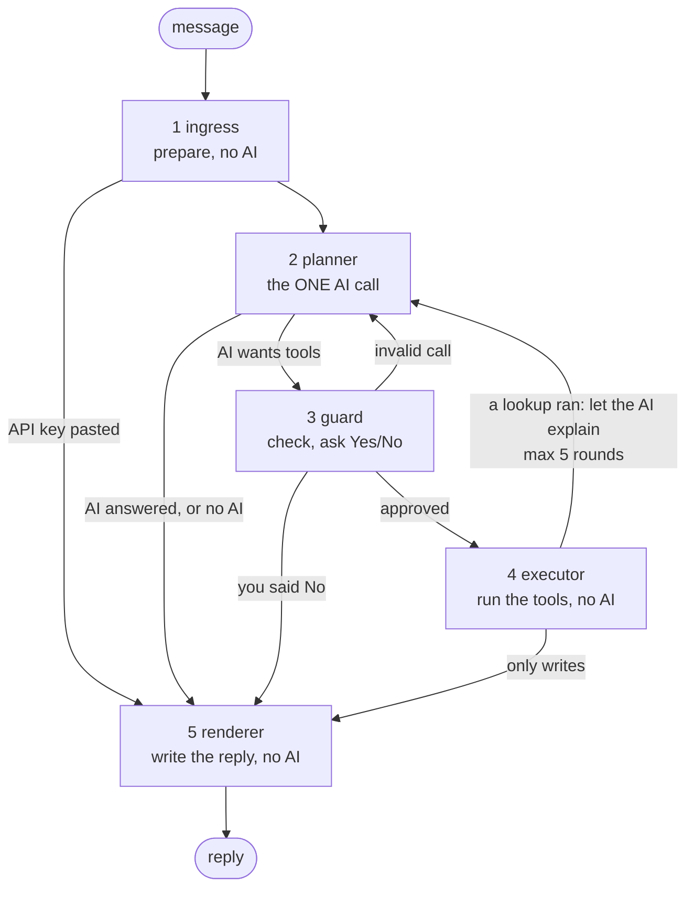

# How it works: the flow, the database, the run

One page. Part 1 is the LangGraph agent, part 2 is the database, part 3 is the run from
`uvicorn main:app` to a reply. For likely questions and answers see [TECH_QA.md](TECH_QA.md).

## Find any function

[CODE_MAP.md](CODE_MAP.md) lists **every function with its line, what it does, who calls it and what it calls**,
starting with the path of one message from `uvicorn` to the reply. In a terminal:
`uv run python scripts/code_map.py who planner_node` (works for any name). It is generated from the code,
so re-run `uv run python scripts/code_map.py` after changes.

## See it live (no AI key needed)

| Where | How |
|---|---|
| **Terminal** | always on: every step prints one line **plus where it is in the code** (see below). `FLOW_CODE=false` hides the code lines |
| **Telegram** | `/flow on`: every reply ends with "How I got here". `/flow code`: the same plus file:line and caller under each step. `/flow off` hides it. `SHOW_FLOW=true` makes `on` the default |
| **Demo** | `uv run python scripts/show_flow.py` runs three messages through the real graph and prints the flow **and the database rows** after each step |
| **Diagram** | `uv run python scripts/show_flow.py --graph` prints the real graph as Mermaid, so the picture cannot drift from the code |

**What the terminal prints for one message** ("spent 450 on dinner"). Read the `at`/`from`/`calls`
lines as: *this function ran* / *this function sent the graph here* / *and it calls these*:

```
planner: round 1: the AI picked 1 tool(s): log_expense(amount=450, category=Food & Dining)
    at    app/bot/agent.py:1020 planner_node()
    from  app/bot/agent.py:1259 route_after_ingress()  (it sent the graph here)
    calls app/services_ai/tool_client.py:139 available_tools(), app/services_ai/ai_gateway.py:696 complete()
executor: ran 1 tool(s): log_expense: inserted 1 transaction (expense Rs 450, ...); Cash balance now Rs 550
    at    app/bot/agent.py:1230 executor_node()
    from  app/bot/agent.py:1267 route_after_guard()  (it sent the graph here)
    calls app/services_ai/tool_client.py:125 call_tool() -> app/services_ai/mcp_server.py:677 execute_tool()
          -> app/services_ai/mcp_server.py:58 log_expense() -> app/services/ledger.py:238 record_transaction()
```

Line numbers are read from the running code, so they are always current.

---

## 1. The LangGraph agent

**In one sentence:** the AI proposes, plain code checks, and only the ledger writes.



| # | Node | AI? | What it decides | Terminal line looks like |
|---|---|---|---|---|
| 1 | **ingress** | no | Is this a pasted API key (save it, never show the AI)? Otherwise mask card/ID numbers, load the user's accounts, budgets and last 20 messages | `loaded 2 account(s) and 6 earlier message(s)` |
| 2 | **planner** | **yes** | The only AI call. Given the message and the tool list: call tools, or answer in words, or decline an off-topic request | `round 1: the AI picked 1 tool(s): log_expense(...)` |
| 3 | **guard** | no | Is each call valid (known tool, real amount, sane date)? Does it need a human Yes (transfer of Rs 5,000+, edit, delete, over-budget)? If so the graph **pauses** here | `all checks passed` / `paused, waiting for your Yes/Cancel` |
| 4 | **executor** | no | Runs each approved call through the tool layer with the user's id forced in, collects results | `log_expense: inserted 1 transaction ...` |
| 5 | **renderer** | no | Picks the reply: the AI's words if every rupee figure is in the user's data, otherwise a fixed template | `reply written from a fixed template` |

**The three decisions that matter**
1. **After planner:** tools wanted → guard; plain answer, no AI key or AI error → renderer.
2. **In guard:** risky → pause (`interrupt()`); the user's Yes/Cancel resumes the *same* run; No → renderer
   with "Cancelled". An answer older than 5 minutes is refused.
3. **After executor:** if a lookup ran (balances, spending), go back to the planner so the AI can explain
   the numbers; if it was only writes, render. At most **5 planner rounds** per message.

**Why this is safe:** the AI never touches the database. It can only name tools; the guard validates, the
executor forces `user_id`, and `ledger.py` re-validates and writes. The pause state is kept per chat in
memory (`thread_id = chat_id`), so a restart drops a waiting question (by design).

**Where each node lives** (the function names are stable; the terminal prints the current line numbers):

| Node | Function | Sent here by | Calls |
|---|---|---|---|
| ingress | `agent.ingress_node` | the graph entry, after `process_user_interaction_ex` | `gr.check_input`, `_load_context`, `_history_dicts`, `prompts.build_planner_prompt` |
| planner | `agent.planner_node` | `route_after_ingress`, `route_after_guard`, `route_after_executor` | `tool_client.available_tools`, `ai_gateway.complete` (the one AI call) |
| guard | `agent.guard_node` | `route_after_planner` | `gr.check_call`, `confirmation_reason`, `_budget_overage_reason`, then `interrupt()` |
| executor | `agent.executor_node` | `route_after_guard` | `tool_client.call_tool` -> `mcp_server.execute_tool` -> the tool -> `ledger.*` |
| renderer | `agent.renderer_node` | any of the four `route_after_*` | `replies.compact`, `gr.leaks`, `gr.ungrounded_figures`, `gr.sanitize_reply` |

The `route_after_*` functions are the graph's decisions (they return the name of the next node). The graph
itself is wired in `agent.build_agent_graph`. Everything is in `app/bot/agent.py` except the checks
(`app/bot/guardrails.py`) and the display (`app/bot/flow.py`).

---

## 2. The database: how it is stored, what happens

**Seven tables, everything keyed by the user:** `users` (one row per Telegram chat id), `accounts` (Cash,
Bank, cards: **the balance lives here**), `transactions` (every expense, income and transfer),
`categories`, `merchants`, `api_keys` (the user's own AI keys), `chat_messages` (history the agent reloads).
Every table except `users` has a `user_id` with `ON DELETE CASCADE`; every query filters by it.

**One message writes in one commit.** For "spent 450 on dinner" the ledger, in a single database transaction:

1. checks the amount (finite, > 0, 2 decimals) and that the account can cover it,
2. locks the account row (`SELECT ... FOR UPDATE`),
3. gets-or-creates the category and merchant rows,
4. **updates** `accounts.balance` and **inserts** the `transactions` row, then commits.

A crash between 4a and 4b is impossible: both happen or neither does. Transfers are the same idea: two
balance updates plus one `transfer` row. Reading ("how much did I spend?") writes nothing; a paused
confirmation writes nothing until the user says Yes.

**What it looks like stored** (real output of `scripts/show_flow.py`):

```
accounts      : Bank = 14,000, Cash = 6,550
transactions  : income      20,000  Bank  description=enc1:gAAAAABq0hLkJfxAsitT28ULJiv_y...
transactions  : income       1,000  Cash  description=enc1:gAAAAABq0hLkNpKeC7qatYv0kOW38...
transactions  : expense        450  Cash  description=-
transactions  : transfer     6,000  Bank  description=enc1:gAAAAABq0hLkslOUtEbpF_70AeHm0...
```

Free text is encrypted at rest (`enc1:` = Fernet): `transactions.description`, `chat_messages.content`,
`api_keys.encrypted_key`. Amounts and dates stay plain so totals and charts work in SQL.

**Where:** `app/services/ledger.py` (the only code that changes balances), `app/models.py` (tables),
`app/db.py` (SQLite or PostgreSQL, startup upgrade), `app/crypto.py` (encryption).

---

## 3. From `uvicorn main:app` to the reply

**A. Starting up** (happens once, in this order)

| Step | What runs | File |
|---|---|---|
| 1 | uvicorn imports `main`. First thing: `firstrun.ensure_setup()` asks the setup questions if the bot is not configured yet | `main.py`, `app/firstrun.py` |
| 2 | Settings are read from `.env` (token, secret key, database URL, tool mode) | `app/config.py` |
| 3 | The database engine is built (SQLite or PostgreSQL) and the **LangGraph agent is compiled once** with an in-memory checkpointer | `app/db.py`, `app/bot/agent.py` |
| 4 | The FastAPI app is created; routers (`/bot/...`, dashboard) and `/static` are attached | `main.py` |
| 5 | uvicorn starts the **lifespan**: `init_db()` creates tables and adds any new columns; refuses a weak `SECRET_KEY` on a public URL | `main.py`, `app/db.py` |
| 6 | `tool_client.start()`: tools run in-process (`direct`) or an MCP server is spawned (`mcp`) | `app/services_ai/tool_client.py` |
| 7 | `telegram.start()`: no token = off; otherwise long **polling** (local) or **webhook** (production). `/health` now answers | `app/bot/telegram.py` |

**B. One message** (what the terminal shows, top to bottom)

| Step | What happens | File |
|---|---|---|
| 1 | Telegram delivers the update (polling, or `POST /bot/webhook` with the secret header checked) | `app/bot/telegram.py`, `app/bot/main.py` |
| 2 | `on_text` shows "typing" and calls `handle_incoming(chat_id, text)` | `app/bot/telegram.py` |
| 3 | `handle_incoming`: allow-list, pending statement import, `/commands` and buttons (plain code, no AI), pasted keys, first-contact setup | `app/bot/main.py` |
| 4 | Anything else goes to the agent: `process_user_interaction_ex` saves the message, then runs (or resumes) the graph: **ingress, planner, guard, executor, renderer** | `app/bot/agent.py` |
| 5 | The executor calls tools; the **ledger** writes to the database (part 2) | `app/services_ai/`, `app/services/ledger.py` |
| 6 | The reply is saved to `chat_messages`, turned into text plus buttons (Undo, Yes/Cancel), and `deliver` sends it. With `/flow on` the steps are appended | `app/bot/main.py`, `app/bot/telegram.py` |

Shutdown reverses it: Telegram stops, then the tool layer.
