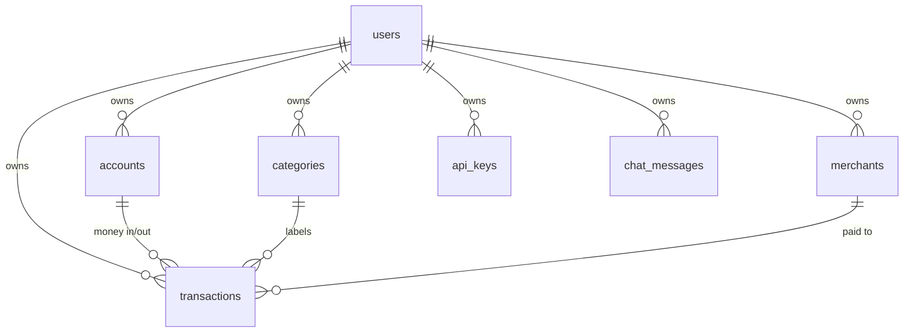
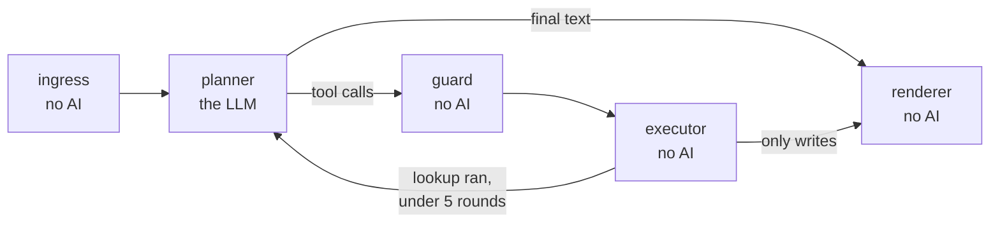
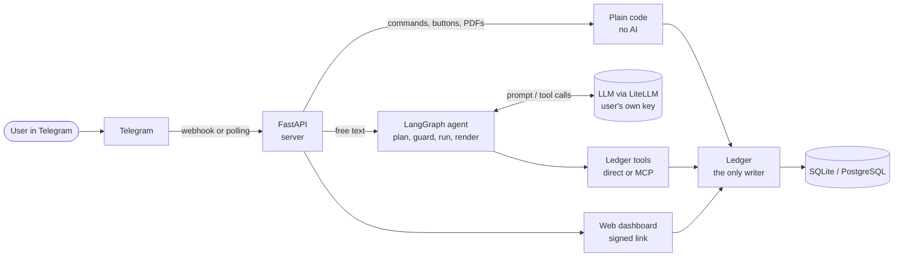

# WalletLedger: technical Q&A sheet

Read this top to bottom once, then use it as a lookup. Each section has the same shape: **what it is
here**, **why we chose it**, **how it is wired (files)**, **questions you will be asked**, **honest limits**.

**The system in one breath.** A user chats with a Telegram bot. FastAPI receives the message. A LangGraph
agent asks an LLM what to do. The LLM can only act through a fixed set of ledger tools (served directly or
over MCP). The ledger validates and writes to a SQL database. Deterministic guardrails sit before and
after the model.

| Fact to remember | Value |
|---|---|
| Stack | Python 3.14, FastAPI, aiogram (Telegram), LangGraph, LiteLLM, MCP, SQLAlchemy 2 |
| Database | SQLite by default, PostgreSQL in production, 7 tables |
| Tools the AI can call | 20 distinct (21 registry entries, one is an alias) |
| Agent graph | 5 nodes, 1 LLM call per plain entry, max 5 planner rounds per message |
| Asks "are you sure?" | transfer of ₹5,000 or more, any edit, any delete, budget overspend |
| AI providers | 9 (Gemini, OpenAI, Anthropic, Groq, OpenRouter, xAI, DeepSeek, Mistral, Ollama) |
| Tested (full repository) | 57 evaluation cases: 47/53 with a model (88.7%) + 4/4 without; 634 unit tests |

---

## 1. Database

**What it is here.** SQLAlchemy 2 ORM over **SQLite** (default: local, single user, zero setup) or
**PostgreSQL** (production), chosen by one setting, `DATABASE_URL`. Files: `app/db.py`, `app/models.py`
(the models are the schema; tables are created at startup).

**The 7 tables.**

`users` is one row per Telegram chat id (recurring bills are detected from `transactions`, not stored). `accounts` are the "pipes" (Cash, Bank, cards) and hold the
balance. `transactions` is every expense, income and transfer. `api_keys` holds the user's own AI keys.
`chat_messages` is the short conversation history the agent reloads (last 20).

**Why these choices.**
- **SQLite + PostgreSQL behind one ORM.** SQLite makes first run and demos trivial (WAL mode, foreign
  keys on). PostgreSQL gives real concurrency in production (pool of 5 + 10 overflow, connections
  recycled every 30 min, `pool_pre_ping`). Same code, one config line.
- **Relational, not document.** Money needs transactions, constraints and joins ("spend by category by
  month"). A ledger is the textbook relational case.
- **Everything hangs off `user_id`** with `ON DELETE CASCADE`: data isolation by construction, and
  deleting a user deletes everything of theirs. Every query filters by `user_id` (identity = chat id).

**How a write stays correct (`app/services/ledger.py`).** It is the *only* code allowed to change a
balance. For each write: validate (amount finite, > 0, rounded to 2 decimals, ≤ 10 billion, date not in
the future) → lock the account row (`SELECT … FOR UPDATE`) → update the balance **and** insert the
transaction in **one** DB transaction → block an overdraw (balance would go below 0). So a crash can never
leave a balance changed without its transaction row.

**Encryption at rest.** Three columns are encrypted: `transactions.description`, `chat_messages.content`,
`api_keys.encrypted_key` (Fernet, key derived with HKDF from `SECRET_KEY`, `enc1:` prefix, rotation with
`scripts/protect_data.py`). Consequence to know: **encrypted columns cannot be used in `WHERE`/`ORDER BY`**,
so text search runs in Python after decrypting.

**See it happen:** `uv run python scripts/show_flow.py` prints the raw rows after each step, including
the encrypted `enc1:` descriptions; `docs/FLOW.md` explains the write path.

**Questions you will be asked.**
- *Why not MongoDB / a cloud DB?* Relational integrity and aggregations are the job; Postgres is the
  production target and SQLite is the zero-setup default.
- *How do you handle two messages at once?* Row lock on the account inside a single transaction
  (Postgres). SQLite serialises writers.
- *Can one user see another's data?* No: `user_id` on every table and every query, plus tests for it.
- *What if the database is lost?* It holds everything; back it up like any Postgres. CSV export exists
  (`/export`) as the user's own copy.

**Honest limits (say them first).**
- **Money is stored as `Float`, rounded to 2 decimals**, not as integer paise or `Numeric`. Rounding is
  applied at every write, but a financial system should use `Numeric(14,2)` or integer minor units. This
  is the first thing to fix before real money.
- **No migration tool** (no Alembic). New columns/indexes are added by a startup routine
  (`ALTER TABLE … ADD COLUMN`, `CREATE INDEX IF NOT EXISTS`) in `app/db.py`. Fine for a small project,
  not for a large team.

---

## 2. FastAPI

**What it is here.** The web server. It does **not** contain the business logic; it exposes the HTTP
surface and starts everything. Files: `main.py`, `app/bot/main.py` (webhook routes),
`app/web/dashboard.py` (dashboard API).

**Startup/shutdown (`lifespan` in `main.py`).** Create tables → refuse to run if `SECRET_KEY` is weak
while the public URL is https → start the tool layer (direct or MCP) → start Telegram (off / polling /
webhook) → on shutdown stop both.

| Route | Purpose |
|---|---|
| `GET /` , `GET /health` | status; `/health` reports the Telegram mode and the tool mode (also the container health check) |
| `POST /bot/webhook` , `/bot/webhook/{bot_id}` | Telegram delivers updates here; the secret header is checked with a constant-time compare; body capped at 1 MB |
| `POST /bot/simulate_chat` | developer endpoint to send a message without Telegram; **off by default on a public host**: it is on only when no bot token is set and the public URL is not https (or when `ENABLE_DEV_ENDPOINTS` forces it), because it can act as any chat id |
| `GET /d/{token}` | the web dashboard page, opened through a **signed, expiring link** |
| `GET /api/dashboard`, `/api/transactions`, `/api/export.csv` | JSON and CSV behind the same signed token |
| `POST /api/webapp/auth` | Telegram Mini App sign-in (validates Telegram's signed `initData`) |
| `/static/*` | dashboard HTML, CSS, JS (no frontend framework, no build step) |

**Why FastAPI.**
- **Async-native.** aiogram (Telegram) and LiteLLM (AI calls) are async; the server must not block while
  waiting for a model.
- **Pydantic validation** for request bodies and settings (`pydantic-settings` reads `.env`).
- **Small and standard**: uvicorn, automatic OpenAPI docs at `/docs`, easy testing.

**Two ways to receive Telegram messages.** *Polling* (the bot asks Telegram for updates: works on a laptop,
no public URL) and *webhook* (Telegram calls `/bot/webhook`: what production uses). One setting
(`USE_WEBHOOK`) switches them; the handlers are the same.

**Questions you will be asked.**
- *Why not Flask or Django?* We need async I/O and typed request models, not an ORM/admin/templating
  stack; SQLAlchemy is used directly.
- *Is everything async?* The web layer and AI calls are. The database layer is synchronous SQLAlchemy, run
  in threads (`asyncio.to_thread`) wherever it is called from async code.
- *How is the dashboard secured?* Links are HMAC-SHA256 signed with `SECRET_KEY`, contain the chat id and
  an expiry (`DASHBOARD_LINK_MINUTES`), and are only ever sent to that chat. The pages are read-only and
  served with security headers.
- *Can it run on several workers?* The API yes; the "waiting for Yes/Cancel" state is in memory
  (section 4), so use one worker or add a shared store first.

**Honest limits.** No rate limiting beyond Telegram's own; the dashboard is read-only by design; dev
endpoints must stay off on a public host (they are, unless forced on).

---

## 3. MCP (Model Context Protocol)

**What MCP is.** An open standard for *serving tools to AI clients* over a transport (here: stdio). It is
complementary to function calling: **function calling is how a model asks for a tool; MCP is how tools
are packaged and served** so any compatible client can use them.

**What it is here.** All ledger actions live in **one registry**, `TOOL_REGISTRY` in
`app/services_ai/mcp_server.py` (20 distinct tools: log expense/income, transfer, balances, search, edit,
delete, budgets, spending breakdown, savings plan, recurring-bill detector, emergency fund, advice bundle…).
The *same functions* are registered as MCP tools (`mcp.tool(name)(handler)`), so there is one definition.

**Two modes, one door (`app/services_ai/tool_client.py`).**

| `TOOL_MODE` | What happens | When |
|---|---|---|
| `direct` (default) | calls the registry function in the same process | production, fastest |
| `mcp` | starts `python -m app.services_ai.mcp_transport` and talks JSON-RPC over stdio | demo, other MCP clients |

Callers only use `tool_client.call_tool()`; they never know which mode is on. Both modes pass the same
tests, and in the evaluation they gave identical results (MCP added about 3 ms per message).

**Why.**
1. **A hard boundary for the AI.** The model can only do what a named, validated tool allows. It cannot
   run SQL or touch a balance directly; tools call `ledger.py`.
2. **Reuse.** Any MCP client (another agent, a desktop AI app) can use the same ledger tools.
3. **Safety by construction.** The executor overwrites `user_id` on every call, so a model can never act
   on another user's data, whatever it outputs.

**Questions you will be asked.**
- *Why MCP if direct calls work?* The registry makes tools reusable and testable as a protocol; direct
  mode is just the fast path. We can say which mode is on at `/health`.
- *Does the model see the database?* No. It sees tool names, argument schemas and tool results.
- *What stops a bad tool call?* The guard node validates arguments (known tool, required fields, positive
  amounts, valid non-future dates, max 10 writes per message) and risky calls need a Yes first; the ledger
  validates again.

**Honest limits.** The tool list shown to the LLM (`TOOLS_SCHEMA` in `agent.py`) is hand-written, while
MCP derives its schema from the function signatures, so the two can drift (a test should compare them).
The stdio MCP mode is per-process and optional.

---

## 4. LangGraph (the agent)

**What it is here.** The agent is a small **state graph** with five nodes, in `app/bot/agent.py`.
One-page explanation: `docs/FLOW.md`.

| Node | AI? | Job |
|---|---|---|
| ingress | no | short-circuits a pasted API key, masks card/Aadhaar/PAN/OTP numbers, loads context + last 20 messages |
| planner | **yes** | the single LLM call: prompt + context + tool list in, tool calls or final text out |
| guard | no | validates calls; pauses with `interrupt()` when a call needs the user's Yes |
| executor | no | injects `user_id`, runs tools, feeds results back |
| renderer | no | uses the model's text only if every rupee figure is grounded in real data, else a fixed template |

**Why a graph and not a free-running agent.**
- **Bounded**: max 5 planner rounds, max 10 writes; it cannot loop forever or spam the ledger.
- **Inspectable**: each step is a node with one job; four of the five nodes need no AI at all, so they
  are tested without one.
- **Human in the loop is native**: `interrupt()` pauses the run *inside* the graph and
  `Command(resume=…)` continues it. The pending state is kept by a checkpointer keyed by `thread_id =
  chat_id`.

**Human in the loop.** Transfers of ₹5,000 or more, any edit or delete, and budget overspends stop at the
guard and ask Yes/Cancel (inline buttons, or a typed reply read by a small yes/no/new classifier). A pending
question expires after 5 minutes; a new request cancels the old one.

**Guardrails (all deterministic, `app/bot/guardrails.py`).**
- *Input*: 2,000 char cap; PII masked before the model or the chat history sees it.
- *Scope*: money topics only; off-topic gets a fixed reply; a message mixing money with off-topic asks
  "Should I still log it?" before writing.
- *Tool*: known tool, valid arguments, amounts and dates sane.
- *Output*: no keys or system-prompt text; **every rupee figure must exist in the user's data, the tool
  results or the message (or be simple arithmetic on them)**, otherwise the reply is replaced by a
  template built from real results.

**The model layer.** LiteLLM behind `app/services_ai/ai_gateway.py`: the user's own key first, then shared,
then server keys; automatic rotation and fallback; 9 providers; the model is discovered from the key
(no hard-coded model names). **Bring-your-own-key**: the operator does not pay for everyone's usage.
Cost: 1 model call for a plain entry, 2 for a question or advice.

**See the flow live.** Every step prints one line in the terminal (`[chat 123] planner: round 1: the AI
picked log_expense(...)`), and `/flow on` shows the same lines under each Telegram reply. A one-page
explanation with the real diagram is `docs/FLOW.md`; `uv run python scripts/show_flow.py` demos it with no AI key.

**How we know it works.** A 57-case evaluation with exact expected ledger outcomes
(the `evals/` folder of the full WalletLedger repository). Latest: **47/53** model-backed cases and 4/4 no-AI cases; 100% tool
selection, 100% of risky actions asked first, 100% of questions kept out of the ledger, 0 safety
violations.

**Questions you will be asked.**
- *Why LangGraph, not a plain loop or LangChain agents?* We needed an explicit loop with a cap, guarded
  tool execution and a pause for human approval. Those are first-class in LangGraph.
- *Why one agent, not many?* One planner plus specialist tools keeps cost (1–2 calls) and failure modes
  low; roles (ledger, analyst, planner, writer) are prompt instructions, not separate agents.
- *How do you stop hallucinated numbers / prompt injection?* Output grounding check, tool-level
  validation, `user_id` forced by code, off-topic and "ignore your instructions" cases in the evaluation
  (injection moved no money in any test).
- *What if the AI is down or there is no key?* Commands and buttons still work; free text gets a short
  "add a key" hint and nothing is logged.
- *Why did the rules engine go?* A hand-written parser was brittle for real language ("recieved salry");
  the planner reads any phrasing and the ledger still enforces the money rules.

**Honest limits.**
- **Pending confirmations live in memory** (`InMemorySaver`): a restart clears them, and several workers
  would not share them. Move to a Postgres/SQLite checkpointer for production.
- **Every free-text message needs an AI key** (user's or the server's).
- The evaluation found a trailing date ("…80 auto yesterday") being applied to all items, and some advice
  quoting figures that cannot be traced to tool results (2 of 5 advice replies passed the strict check).

---

## 5. Architecture diagram (simplified)

**One message, six steps.**
1. The user sends "spent 450 on dinner" in Telegram.
2. Telegram calls the FastAPI webhook (secret header checked); the router sees it is not a command.
3. The agent masks sensitive numbers, loads context, and the **planner** (LLM) picks `log_expense`.
4. The **guard** validates the call (and asks Yes/Cancel if it were risky); the **executor** runs it.
5. The **ledger** validates, locks the account, updates the balance and inserts the transaction in one
   database transaction.
6. The **renderer** writes a short reply (checking every figure is real) and Telegram shows it with an
   Undo button.

**Where each rule lives (use this to answer "who is responsible for…").**
| Concern | Owner |
|---|---|
| Understanding the sentence | LLM planner |
| Money rules (no overdraw, amount > 0, future dates) | `ledger.py`, never the prompt |
| Who the data belongs to | `user_id` forced by the executor, filtered in every query |
| Risky actions | guard node (`interrupt()`) |
| Numbers shown to the user | renderer grounding check |

---

## 6. Why a Telegram bot

**Product reasons.**
- **Zero-install UI.** People already have Telegram open. Chat, inline buttons, charts as images and file
  upload (PDF bank statements) come for free, so there is no mobile app and no frontend to build.
- **Identity for free.** Every message carries a stable chat id, so there is no signup, password or reset
  flow. That id is the key of every table.
- **Fits the job.** Logging an expense should take 5 seconds and one sentence; a chat is the lowest-friction
  form of that.

**Engineering reasons.**
- **The Bot API is free and instant**: a token from BotFather, no business verification.
- **Local development without a public URL** (long polling) and **production with a webhook**; the same
  handlers serve both.
- **A path to richer UI**: the Mini App opens the web dashboard inside Telegram with signed sign-in.
- **The core is channel-independent.** `handle_incoming(chat_id, text)` is the single entry point for any
  channel; Telegram is one adapter (`app/bot/telegram.py`). The developer
  `/bot/simulate_chat` endpoint drives the same handler, so adding WhatsApp or a web chat means writing
  another adapter, not touching the ledger or agent.

**Alternatives we weighed.**
| Option | Why not (first) |
|---|---|
| Native / web app | build and maintain a UI, auth and password reset, and get users to install it |
| WhatsApp Business | business verification and per-conversation pricing; heavier approval; a good *next* channel |
| SMS | cost per message and no buttons, files or charts |
| Slack / Teams | great for work, wrong for personal money |

**Questions you will be asked.**
- *Is it private?* Telegram bot chats are **not end-to-end encrypted** (only "secret chats" are, and bots
  cannot use them). That is why we encrypt stored descriptions, messages and AI keys at rest, mask card,
  Aadhaar, PAN and OTP numbers before the model or history sees them, and never log keys. Be upfront that
  Telegram itself can see the messages.
- *What if Telegram changes or blocks?* Platform dependency is real; the channel-independent core limits
  the cost of switching to a second channel.
- *Group chats? Long answers?* Built for one-to-one chats; messages over 4,096 characters are split.
- *Why would a bank or company trust it?* They would not on Telegram alone; for that, the same core can sit
  behind an authenticated web or WhatsApp front end.

---

## Say these before they are asked (known weaknesses and the fix)

| Weakness | Fix |
|---|---|
| Money stored as `Float` | `Numeric(14,2)` or integer minor units |
| No migration tool | adopt Alembic |
| Pending Yes/Cancel in memory | durable checkpointer (Postgres/SQLite) |
| Tool schema hand-written twice | generate `TOOLS_SCHEMA` from the registry, add a drift test |
| Telegram is not end-to-end encrypted | state it; encryption at rest + PII masking; add a second channel |
| Evaluation used one model, one run | re-run with Gemini when quota allows; more runs |
| Advice figures sometimes not traceable | tighten the output guardrail for persona replies |

## Where to look in the code

| Topic | Files |
|---|---|
| Server and startup | `main.py` |
| Telegram adapter, router | `app/bot/telegram.py`, `app/bot/main.py` |
| Agent graph, guardrails, flow display | `app/bot/agent.py`, `app/bot/guardrails.py`, `app/bot/flow.py` |
| Tools and MCP | `app/services_ai/mcp_server.py`, `tool_client.py`, `mcp_transport.py` |
| Model access | `app/services_ai/ai_gateway.py`, `prompts.py` |
| Money rules | `app/services/ledger.py` |
| Database | `app/db.py`, `app/models.py` |
| Encryption | `app/crypto.py` |
| Dashboard | `app/web/dashboard.py`, `app/web/tokens.py`, `app/web/static/` |
